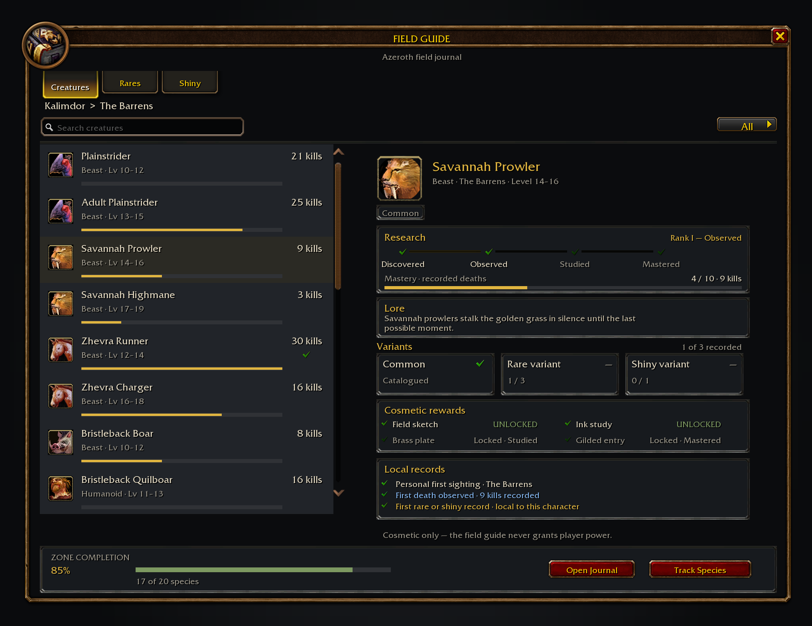
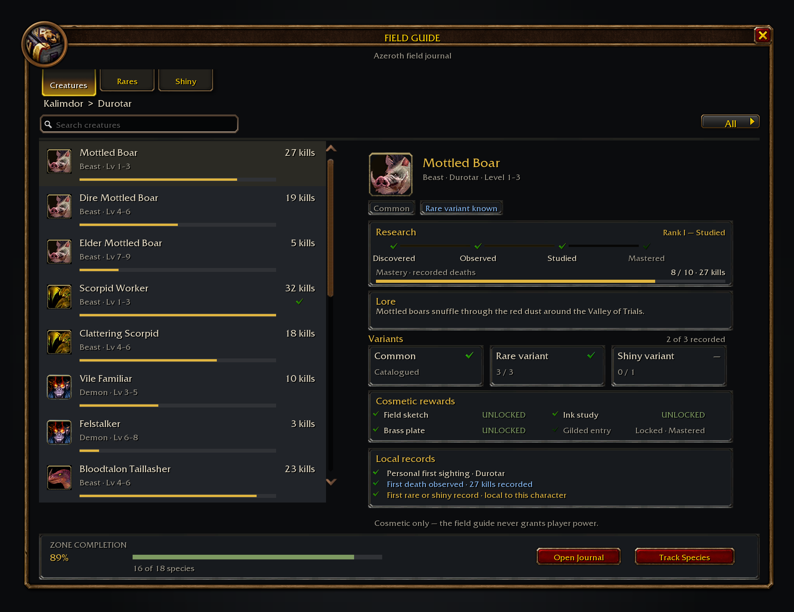
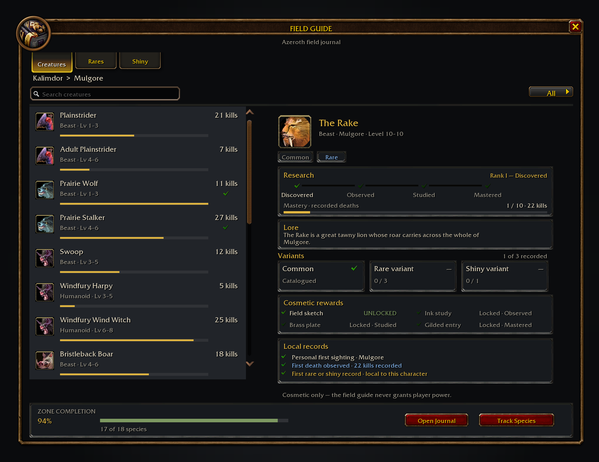
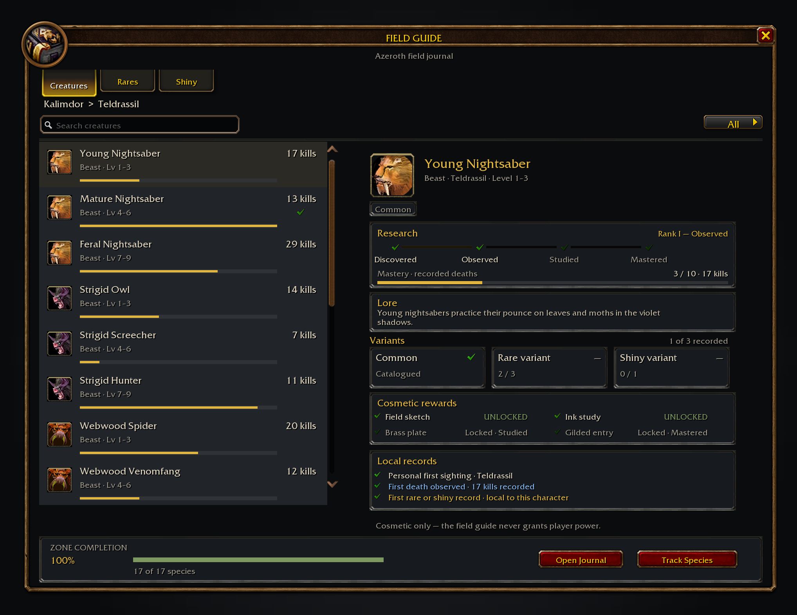
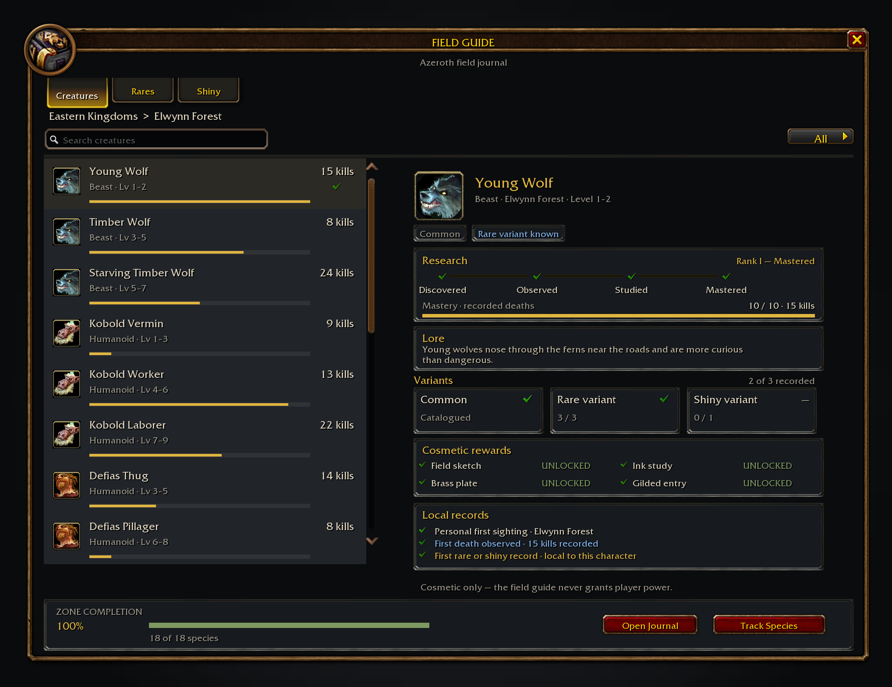
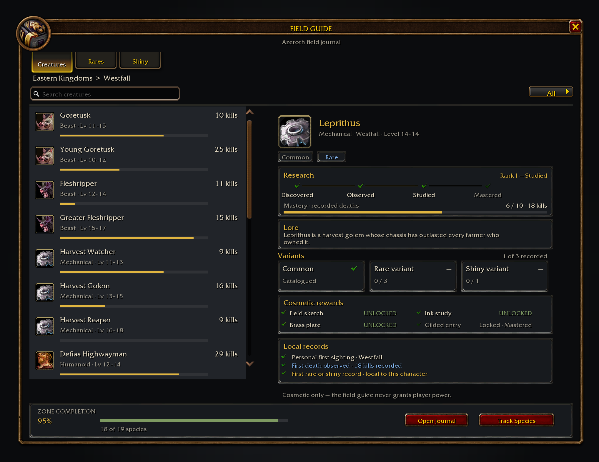
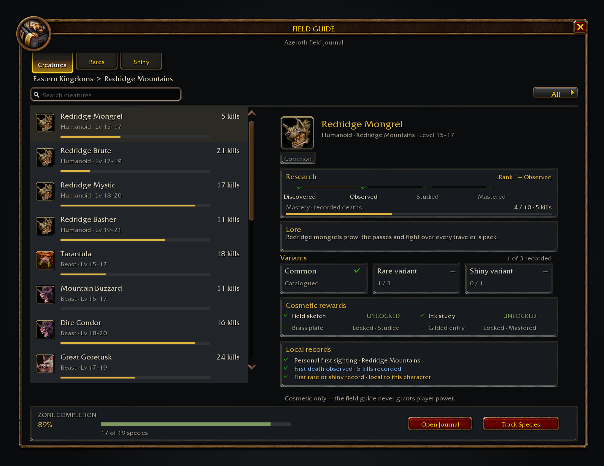
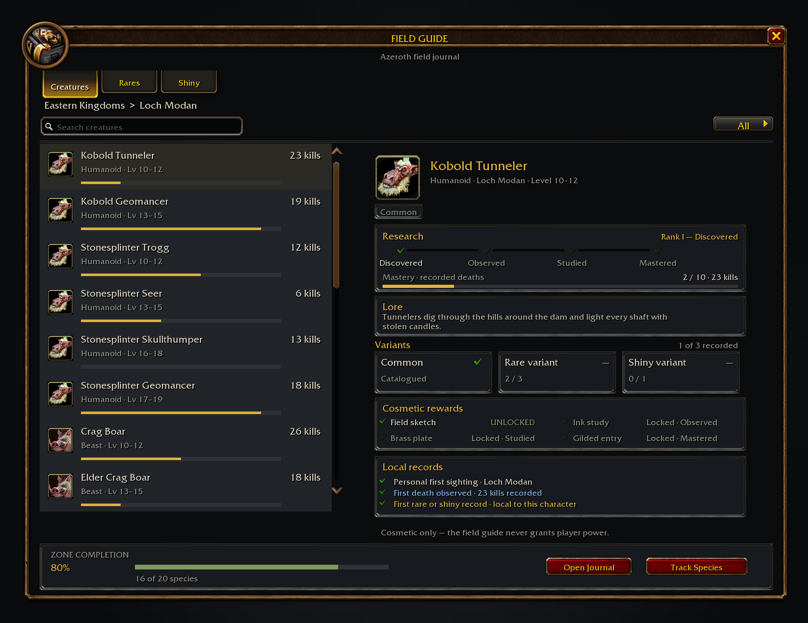
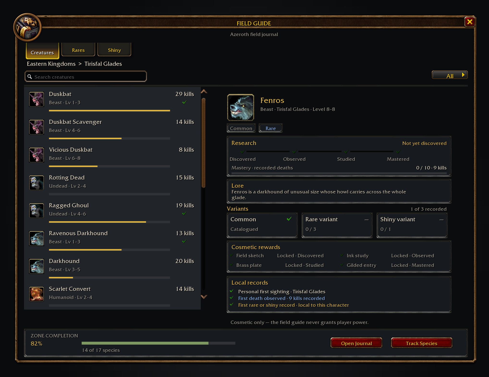
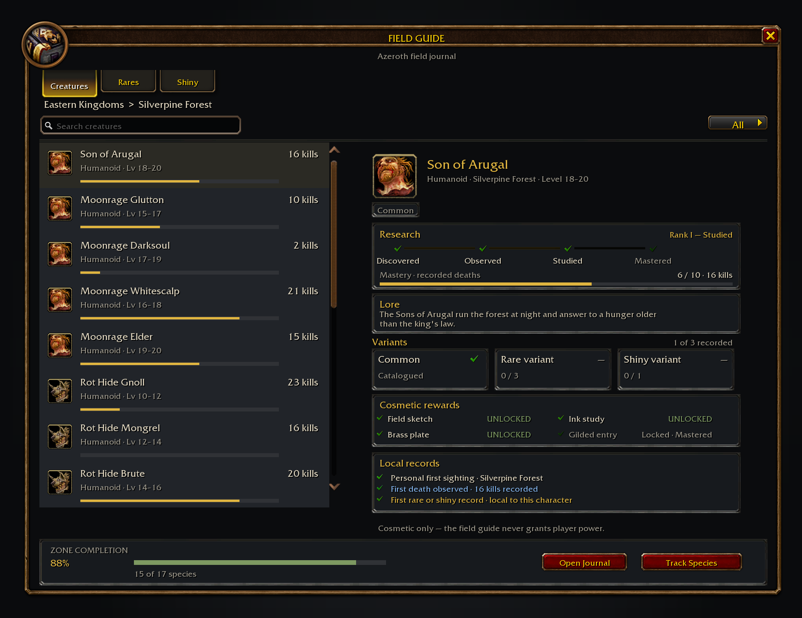

# Field Guide Forever

A field journal for the creatures of Azeroth. Hostile NPC deaths observed in a catalogued zone are recorded in its
creature journal, from the plainstriders of Mulgore to the worgen of Silverpine. The addon records observed deaths,
not killing blows. Rare creatures keep their own variant records, and one observed death in five hundred rolls a
shiny colour variant.

Field Guide Forever is cosmetic only. It never grants player power, changes combat or calls a protected function.

## Features

- A zone-by-zone catalogue of 183 Classic creatures across ten starting zones, each with a real family, level range
  and a line of field notes.
- Uncapped recorded-death totals, with a separate ten-step mastery track: Discovered, Observed, Studied and Mastered.
- Character-local first sightings and first observed deaths, plus first rare and shiny records.
- By default, shared cumulative records and earliest firsts are exchanged with guild and group addon users; disable this
  in the options to stop sending/receiving. Local tracking continues when sharing is off.
- An Instances page for bosses reported by encounter events, with local first clears, attempts, kill totals and
  difficulty records. Entries appear after the client reports an encounter; this is not a verified world-first board.
- Common, rare and shiny variants. A rare species needs three sightings to confirm its rare variant; a shiny is a
  1-in-500 roll on every kill.
- A session sighting log, so the day's walk stays with the journal until the client closes.
- Search, status filters and CREATURES, RARES, SHINY and INSTANCES tabs.
- Tracking for the species you are currently working on.
- A movable, closable window that remembers where you left it. `/fieldguide` or `/fg` toggles it.

## Zones

| Continent | Zones |
| --- | --- |
| Kalimdor | The Barrens, Durotar, Mulgore, Teldrassil |
| Eastern Kingdoms | Elwynn Forest, Westfall, Redridge Mountains, Loch Modan, Tirisfal Glades, Silverpine Forest |

## Research ranks

| Specimens | Rank | What it means |
| --- | --- | --- |
| 1 | Discovered | The species is in the journal. |
| 3 | Observed | Enough sightings to note how it behaves. |
| 6 | Studied | A proper entry, with its habits recorded. |
| 10 | Mastered | The full plate, and the gold mark in the list. |

A species is catalogued in its zone from the first specimen. Zone completion counts catalogued species, not mastered
ones, so the bar moves with every new creature rather than waiting for a long grind.

## Installing

1. Download the zip from the latest release.
2. Extract it so the folder is `World of Warcraft/Interface/AddOns/FieldGuideForever`.
3. Make sure `FieldGuideForever.toc` is directly inside that folder.
4. Restart the client or type `/reload`.

The addon targets the WoW: Forever client, Interface 16001. It has no dependencies.

## Screenshots

The three pages of the journal:

Ten creatures from ten zones, one per page, in the order the catalogue opens them:

| | | |
| --- | --- | --- |
|  |  |  |
|  |  |  |
|  |  |  |
|  | | |

All of them are mock screenshots drawn with the client's own art by `tools/mockups.py` (`python3
tools/mockups.py`). The script reads `Data/Creatures.lua` for the catalogue and lays the window out the way
`UI/Window.lua`, `UI/List.lua` and `UI/Detail.lua` do, drawing the dialog border, panel tabs, buttons, atlas marks and
FRIZQT text from the WoW: Forever client build (`wowmock`, cached under `tools/.cache/wowmock/`), plus a real client
spell icon per species in place of the creature portraits that live in the game archives. The per-species progress is
derived from the species id, so two runs produce identical files.

## Credits

- cjber, for the addon and the rest of the Forever addon suite.
- Blizzard Entertainment, for Azeroth, its creatures and the client art the journal is built from.
- The WoW: Forever project, for the client this addon is written for.
- Everyone who reports a creature that is missing from the catalogue.

World of Warcraft is a trademark of Blizzard Entertainment, Inc. This addon is not affiliated with or endorsed by
Blizzard Entertainment.
