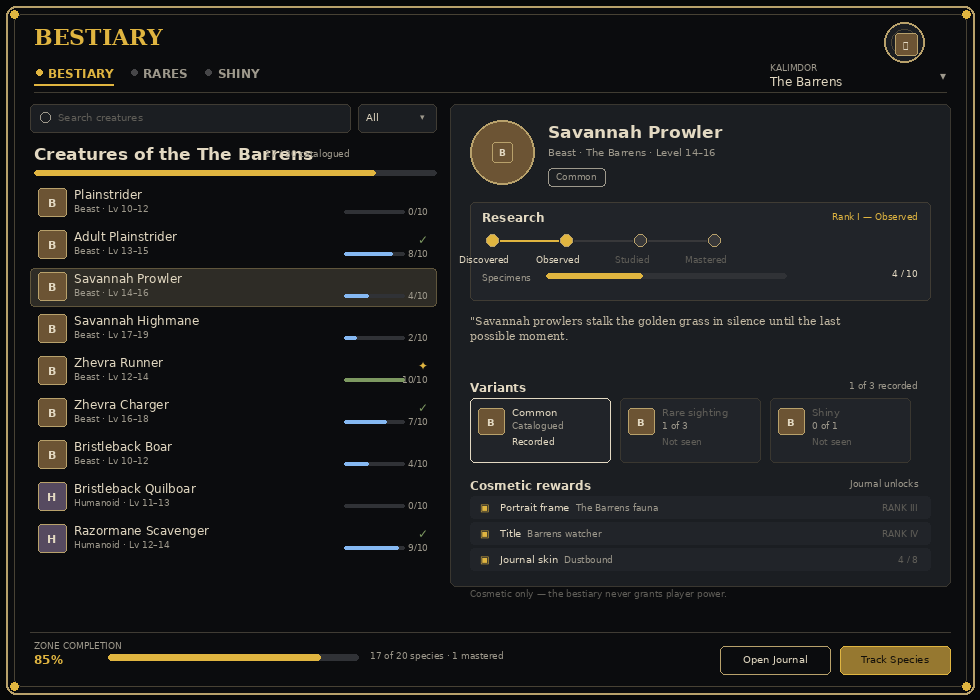

# Bestiary Forever

A field journal for the creatures of Azeroth. Every hostile creature a character kills is recorded in its zone's
catalogue, from the plainstriders of Mulgore to the worgen of Silverpine. Rare creatures keep their own variant
records, and one kill in five hundred turns up a shiny colour variant.

Bestiary Forever is cosmetic only. It never grants player power, changes combat or calls a protected function.

## Features

- A zone-by-zone catalogue of 183 Classic creatures across ten starting zones, each with a real family, level range
  and a line of field notes.
- Specimen counts with four research ranks: Discovered, Observed, Studied and Mastered.
- Common, rare and shiny variants. A rare species needs three sightings to confirm its rare variant; a shiny is a
  1-in-500 roll on every kill.
- A session sighting log, so the day's walk stays with the journal until the client closes.
- Search, status filters and BESTIARY, RARES and SHINY tabs.
- Tracking for the species you are currently working on.
- A movable, closable window that remembers where you left it. `/bestiary` or `/bst` toggles it.

## Zones

| Continent | Zones |
| --- | --- |
| Kalimdor | The Barrens, Durotar, Mulgore, Teldrassil |
| Eastern Kingdoms | Elwynn Forest, Westfall, Redridge Mountains, Loch Modan, Tirisfal Glades, Silverpine Forest |

## Research ranks

| Specimens | Rank | What it means |
| --- | --- | --- |
| 1 | Discovered | The species is in the journal. |
| 3 | Observed | Enough sightings to note how it behaves. |
| 6 | Studied | A proper entry, with its habits recorded. |
| 10 | Mastered | The full plate, and the gold mark in the list. |

A species is catalogued in its zone from the first specimen. Zone completion counts catalogued species, not mastered
ones, so the bar moves with every new creature rather than waiting for a long grind.

## Installing

1. Download the zip from the latest release.
2. Extract it so the folder is `World of Warcraft/Interface/AddOns/BestiaryForever`.
3. Make sure `BestiaryForever.toc` is directly inside that folder.
4. Restart the client or type `/reload`.

The addon targets the WoW: Forever client, Interface 16001. It has no dependencies.

## Screenshots

## Credits

- cjber, for the addon and the rest of the Forever addon suite.
- Blizzard Entertainment, for Azeroth, its creatures and the client art the journal is built from.
- The WoW: Forever project, for the client this addon is written for.
- Everyone who reports a creature that is missing from the catalogue.

World of Warcraft is a trademark of Blizzard Entertainment, Inc. This addon is not affiliated with or endorsed by
Blizzard Entertainment.
