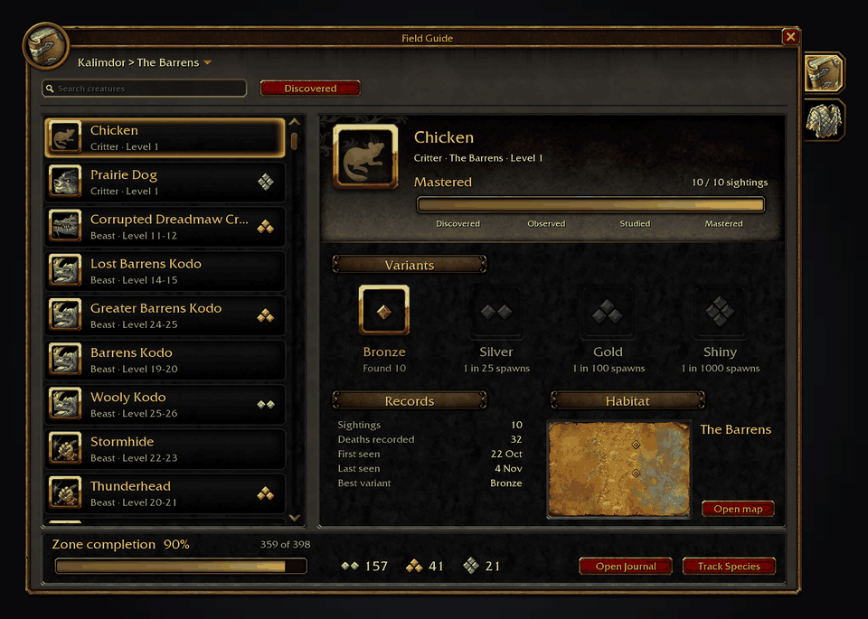
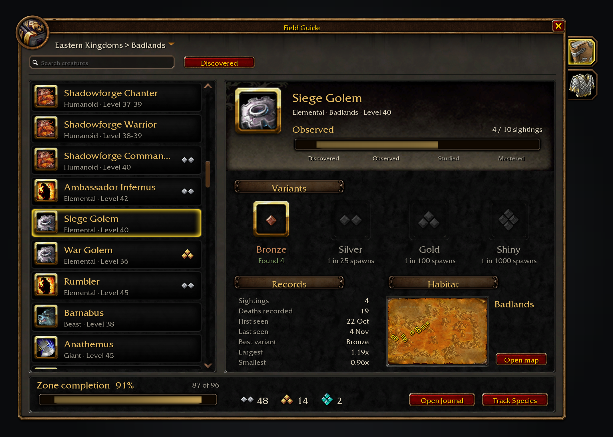
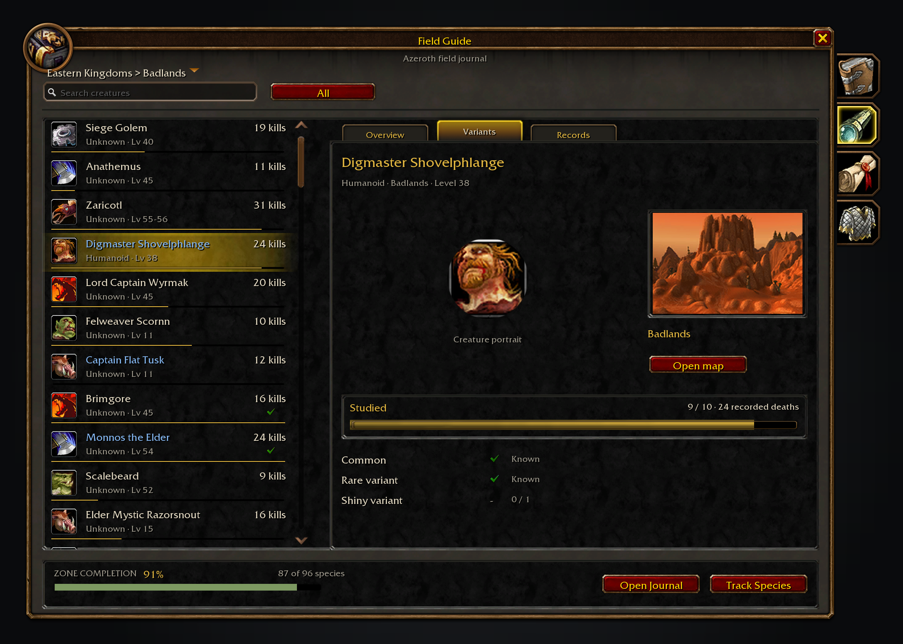
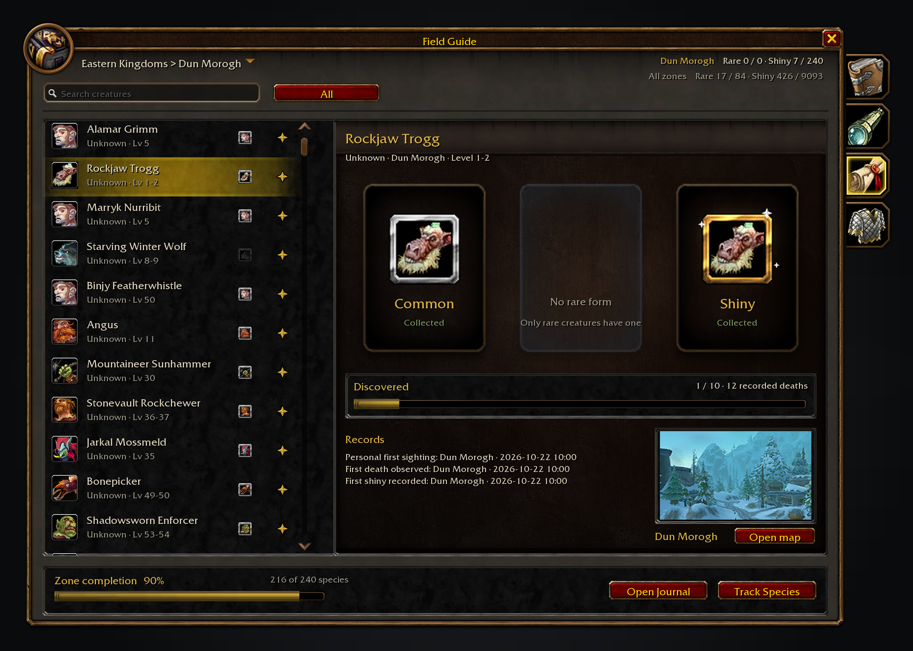

<p align="center"></p>

<h1 align="center">Field Guide Forever</h1>

<p align="center">
A cosmetic journal of the creatures you kill in WoW: Forever, zone by zone.<br>
<a href="https://github.com/cjber/field-guide-forever/actions/workflows/ci.yml"></a>
<a href="https://github.com/cjber/field-guide-forever/releases/latest"></a>
<a href="https://ko-fi.com/cjber"></a>
</p>

Field Guide Forever keeps a journal of the creatures you kill in Azeroth, zone by zone. It is cosmetic only: it never grants power, changes combat or calls a protected function.

<p align="center"></p>

Every catalogued zone has its own page of creatures, with your kills and research rank for each.

<p align="center"></p>

Pick a creature to see its level, zone and how far you are towards Mastered. The bar at the bottom is the zone's completion.

<p align="center"></p>

Rares have their own tab, and the Variants tab shows which forms of a creature you have recorded.

<p align="center"></p>

Records keep the date you first saw a creature, first killed one and first found its rare or shiny variant. [docs/gallery.md](docs/gallery.md) has every rendered scene.

## Features

- **Journal**: creatures across outdoor zones, dungeons and raids, with their level, rank and zone, read from QuestieDB as it updates. Search by name, filter by status, and switch between the Creatures, Rares, Shiny and Instances tabs.
- **Research ranks**: kills move a species through Discovered (1), Observed (3), Studied (6) and Mastered (10). The kill count keeps going after that.
- **Zone completion**: the share of a zone's species you have recorded. It counts recorded species, not mastered ones, so the bar moves with every new creature.
- **Rares and shinies**: a rare variant is confirmed after three sightings, and every recorded kill has a 1 in 500 chance of a shiny.
- **Rarity colours**: some species are silver, gold or shiny, the same for every player. Your target frame and their nameplates take that colour.
- **Records**: first sighting and first kill for each creature, kept per character, and a sighting log for the current session.
- **Tracking**: mark the species you are working on.
- **Discoveries**: a first kill is announced at the top of the screen and tagged New in the journal. Rare, shiny, mastery and zone milestones get the game's achievement toast; click one to open the journal there. Both can be turned off in the options.
- **Instances**: bosses the game reports when an encounter ends, with first clears, attempts and kills by difficulty. It is a personal record, not a verified world-first board.
- **Sharing**: totals and first records are exchanged with guild and group members who run the addon. `/fgf leaderboard` ranks kills, with peer totals marked as reported. Turn sharing off in the options; local tracking carries on.

## Install

Install it from [CurseForge](https://www.curseforge.com/wow/addons/field-guide-forever) or [Wago Addons](https://addons.wago.io/addons/field-guide-forever), or download the zip from [Releases](https://github.com/cjber/field-guide-forever/releases). To install the zip by hand, extract it into the WoW: Forever client's `Interface/AddOns/` folder (`_forever_` on the live client) so you end up with `AddOns/FieldGuideForever/FieldGuideForever.toc`.

Field Guide needs [Questie](https://www.curseforge.com/wow/addons/questie) or the standalone [QuestieDB](https://github.com/Questie/QuestieDB/releases) addon for its creature list. Without one, the window says what to install.

## Usage

Type `/fg`, press Shift-F, or click the Field Guide button in the micro menu. Options are under Options > AddOns > Field Guide Forever, and Shift-F can be rebound in Key Bindings > AddOns.

| Command | What it does |
|---|---|
| `/fg`, `/fieldguide` | Open or close the journal |
| `/fgf leaderboard` | Print the kill leaderboard: you, plus the top ten guild and group members who share |
| `/fgf help` | List the commands |

## How kills are counted

The Forever client keeps the combat log from addons, so Field Guide counts the kills it can see: a creature you have
targeted, or whose nameplate is showing, dies and nobody outside your group tagged it first. A rare also counts when
its map marker, seen alive, turns dead while it is on your minimap. Each death counts once, however many of these
report it. A creature that dies with no nameplate showing and not targeted, or whose name the client hides from
addons, is not counted. Turn on enemy nameplates (`V`) to catch everything you fight.

## Research ranks

| Kills | Rank | What it means |
| --- | --- | --- |
| 1 | Discovered | The species is in the journal. |
| 3 | Observed | Enough sightings to note how it behaves. |
| 6 | Studied | A proper entry, with its habits recorded. |
| 10 | Mastered | The full plate, and the gold mark in the list. |

## Where the creatures come from

Field Guide reads the Forever QuestieDB API at runtime. Creature names, levels, ranks and spawn locations are not
bundled. Client-only zone names, instance types, families and portrait IDs are generated from pinned
[wago.tools](https://wago.tools) DB2 exports by `tools/gen_zones.py`.

## Works alongside

Other addons record some of the same things. Field Guide keeps its own records and shares nothing with them:

| Addon | What overlaps | What happens |
|---|---|---|
| RareScanner | rare kills per creature, and a per-character "rare killed" flag | both keep their own counts from the same kills |
| SilverDragon | per-zone rare sightings with coordinates | Field Guide keeps its own first-sighting record; SilverDragon's history is separate |
| AutoBiographer | a per-creature kill count in unit tooltips | the counts differ: Field Guide counts deaths it sees on your target, nameplates and rare markers, AutoBiographer counts tagged or group credit |

<!-- forever-family:start -->

## The Forever addons

Each one works on its own, and they work together when you install more than one.

| Addon | What it does |
|---|---|
| [Shortest Path Forever](https://www.curseforge.com/wow/addons/shortest-path-forever) | Plans journeys on foot, by air, by sea and through portals, with directions in the tracker. |
| [Adventure Guide Forever](https://www.curseforge.com/wow/addons/adventure-guide-forever) | Suggests quests for your level and routes you from one to the next. |
| [SkillUp Forever](https://www.curseforge.com/wow/addons/skillup-forever) | Shows skill-up chances, recipe costs and levelling routes in the Professions window. |
| [Legacy Forever](https://www.curseforge.com/wow/addons/legacy-forever) | Shows your unfinished Legacy challenges on the world map and tracks the ones you choose. |
| [Tweaks Forever](https://www.curseforge.com/wow/addons/tweaks-forever) | Adds quest automation, rare alerts and merchant options to the game's settings. |

<!-- forever-family:end -->

## Development

```sh
# link the checkout into the game
ln -s "$PWD" ".../World of Warcraft/_forever_/Interface/AddOns/FieldGuideForever"

stylua --check . && luacheck .
bash tools/typecheck.sh                                        # LuaLS 3.19.1, load graph, secret-value lint
for s in tests/*_spec.lua; do luajit "$s" || exit 1; done      # model, data, rarity and API specs
FOREVER_CORE=../forever-core python3 tools/mockups.py          # re-render docs/screenshots and docs/gallery.md
```

[AGENTS.md](AGENTS.md) lists the full gate. The screenshots are mocks drawn from WoW: Forever client art and a
disposable fixture extracted from the pinned QuestieDB Forever release into the ignored `tools/.cache/`; the addon
never ships that fixture.

**Releasing:** move the `[Unreleased]` notes in `CHANGELOG.md` under `## [X.Y.Z] - YYYY-MM-DD`, then
`git tag -s vX.Y.Z && git push --tags`, or run the Release workflow on main with `version` set. The
[BigWigs packager](https://github.com/BigWigsMods/packager) builds the zip and uploads it to GitHub Releases,
CurseForge and Wago, with that version's entry (`tools/changelog.py`) as the release notes.

**Contributing:** read [CONTRIBUTING.md](https://github.com/cjber/.github/blob/main/CONTRIBUTING.md) and this
repository's [AGENTS.md](AGENTS.md). Report security problems privately, as
[SECURITY.md](https://github.com/cjber/.github/blob/main/SECURITY.md) describes.

## Support

The addon is free and stays GPL-3.0. If you enjoy it, you can [buy me a coffee on Ko-fi](https://ko-fi.com/cjber);
nothing is locked behind it and there is no paid version.

## Credits

Creature data comes from [QuestieDB](https://github.com/Questie/QuestieDB), read at runtime, and client data from
[wago.tools](https://wago.tools). Thanks to everyone who reports a creature missing from the catalogue, a bug or a
feature idea, here or on CurseForge. [THIRD_PARTY.md](THIRD_PARTY.md) has the full list.

## Licence

GPL-3.0-or-later. Every input, its pin and licence, and what ships: [THIRD_PARTY.md](THIRD_PARTY.md). World of
Warcraft is a trademark of Blizzard Entertainment, Inc. This addon is not affiliated with or endorsed by Blizzard
Entertainment.

Made by Cillian Berragan · [cillian.dev](https://cillian.dev) · [GitHub](https://github.com/cjber) · [Twitter](https://twitter.com/cjberragan)

Built with AI assistance.
