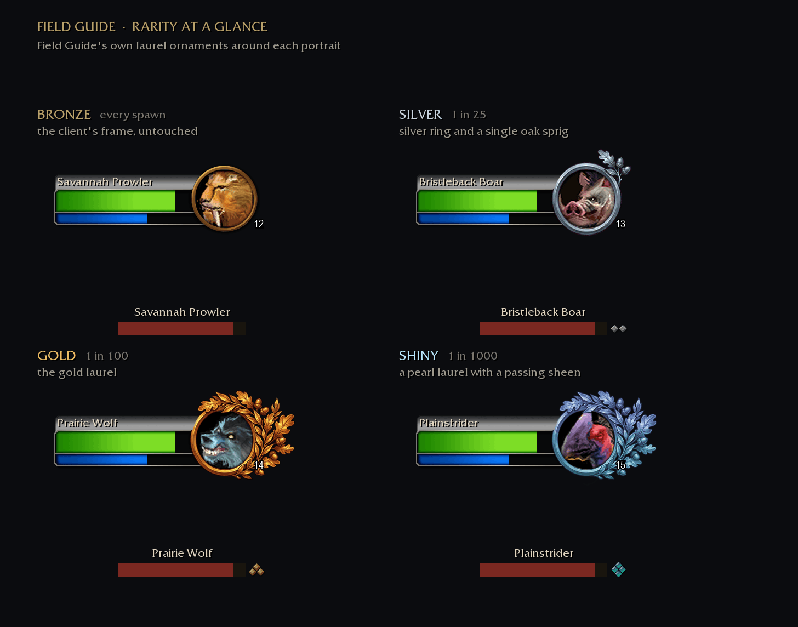
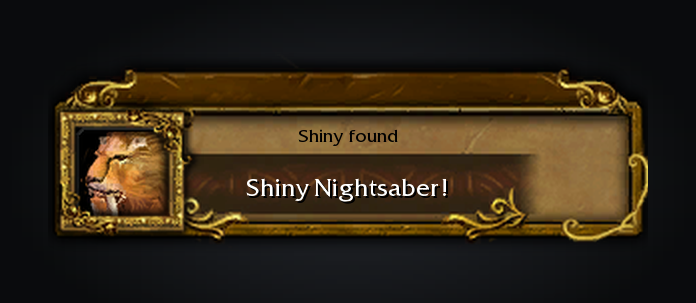
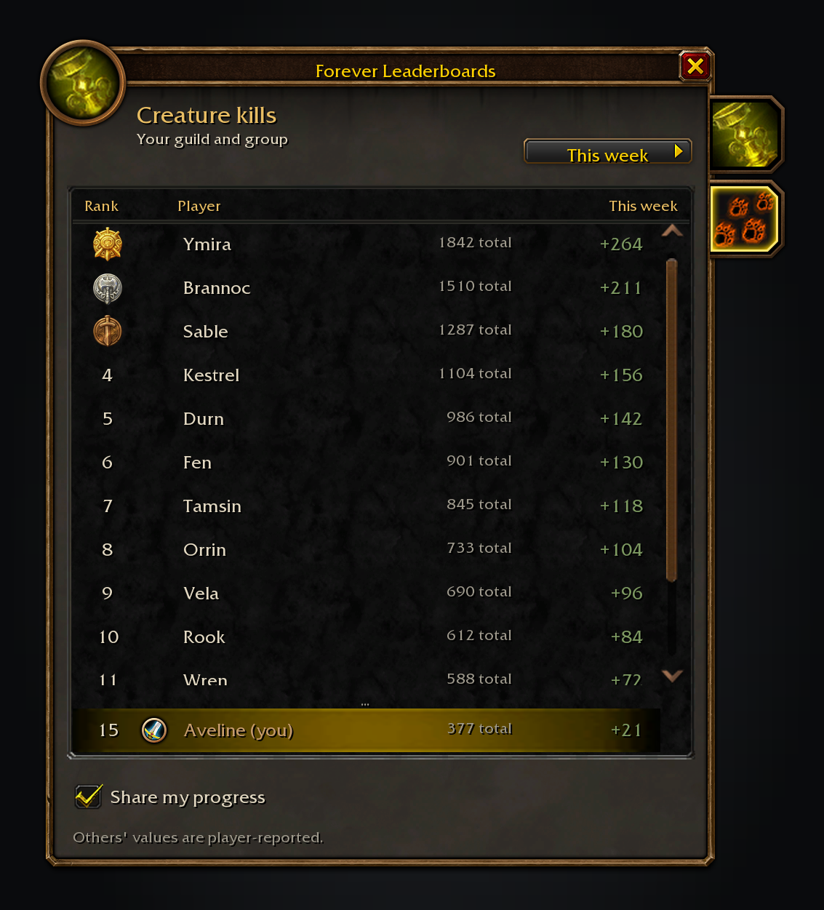

Field Guide Forever gives every creature in WoW: Forever a coat. Most are bronze, but 1 in 25 spawns is silver, 1 in 100 gold and 1 in 1000 shiny, and the target frame and nameplate show it the moment you see one. Every kill goes into a journal of Azeroth's creatures, zone by zone. It is cosmetic only: it never grants power or changes combat.

A silver, gold or shiny spawn wears a laurel ornament around its target portrait, from a single silver sprig to a full gold laurel, and on shiny a pearl laurel with a light sweeping across it. Its nameplate gets the same mark beside the health bar. Every player sees the same coat on the same spawn, so a gold in your group is gold for everyone.

Free, with nothing locked behind it. If you enjoy it, you can [sponsor me on GitHub](https://github.com/sponsors/cjber), which takes no fees, or [buy me a coffee on Ko-fi](https://ko-fi.com/cjber). For help and each day's release notes, [join me on Discord](https://discord.gg/FpHugGxRJY).

  

Every catalogued zone has its own page of creatures, with your kills and research rank for each.

Pick a creature to see its level, zone and how far you are towards Mastered. The bar at the bottom is the zone's completion.

Creatures and Instances share the side rail. The list opens on Discovered. Silver, gold and shiny are filters, and each entry shows all four coats a spawn can wear.

Records keep when you first and last saw a creature, how many deaths you recorded and the best coat you have found.

Your first silver, gold or shiny of a species, a species reaching Mastered and a zone with every creature recorded each get the game's achievement toast. Click one to open the journal there.

Guild and group members who run the addon share their totals. `/fgf leaderboard` ranks everyone by kills this week or all time.

## Features

- **Rarity marks**: a silver, gold or shiny spawn wears a laurel ornament around its portrait that grows from a plain silver ring with one oak sprig to the gold laurel, and shiny wears the same laurel in pearl with a slow light sweeping across it. Silver and shiny also keep the game's rare silver frame. Its nameplate gets the same quality mark to the right of the health bar. Health bars, names and the client's own rare, elite and boss art keep their colours. Bronze creatures look exactly as they always did, and `/fg preview` cycles the three higher coats for this session.
- **Journal**: creatures across outdoor zones, dungeons and raids, with their level, rank and zone. It opens on Discovered, so a new character starts with what they have actually met. Search by name, filter by status or coat, and switch between the Creatures and Instances tabs.
- **Research ranks**: kills move a species through Discovered (1), Observed (3), Studied (6) and Mastered (10). The kill count keeps going after that.
- **Zone completion**: the share of a zone's species you have recorded.
- **The coat ladder**: every spawn is bronze, silver (1 in 25), gold (1 in 100) or shiny (1 in 1000), fixed for that spawn. Every player sees the same coat on the same spawn, and the journal keeps how many of each you have found.
- **Records**: first sighting, first kill and best coat for each creature, kept per character, and a sighting log for the current session.
- **Track Species**: put the species you are working on in the Forever tracker column every Forever addon shares, with its zone, sightings toward Mastered and kills.
- **Discoveries**: a first kill is announced at the top of the screen and tagged New in the journal. Silver, gold, shiny, mastery and zone milestones get the game's achievement toast. Both can be turned off in the options.
- **Instances**: bosses the game reports when an encounter ends, with first clears, attempts and kills by difficulty. It is a personal record, not a verified world-first board.
- **Sharing**: totals and first records are exchanged with guild and group members who run the addon. `/fgf leaderboard` opens the shared Forever Leaderboards window on the Field Guide tab, with this week's progress, the all-time total and peer values marked as reported. Sharing is on unless you turn it off in the options or the window; local tracking carries on.

## How kills are counted

Field Guide counts the kills it can see: a creature you have targeted, or whose nameplate is showing, dies and nobody outside your group tagged it first. A rare also counts when its map marker, seen alive, turns dead while it is on your minimap. Each death counts once.

A creature that dies with no nameplate showing and not targeted is not counted. Turn on enemy nameplates (`V`) to catch everything you fight.

## Usage

Type `/fg` or `/fieldguide`, press Shift-F, or click the Field Guide button on the minimap rim; drag it around the rim to move it, or hide it in the options. `/fg preview` shows every creature as silver, gold or shiny for this session, `/fgf leaderboard` opens Forever Leaderboards on the Field Guide tab and `/fgf help` lists the commands. Options are under Options > AddOns > Field Guide Forever.

Field Guide needs [Questie](https://www.curseforge.com/wow/addons/questie) or the standalone QuestieDB addon for its creature list. Without one, the window says what to install.

<!-- forever-family:start -->

## The Forever addons

Each one works on its own, and they work together when you install more than one.

| Addon | What it does | Issues |
|---|---|---|
| [Shortest Path Forever](https://www.curseforge.com/wow/addons/shortest-path-forever) | Plans journeys on foot, by air, by sea and through portals, with directions in the tracker. | [Issues](https://github.com/cjber/shortest-path-forever/issues) |
| [Adventure Guide Forever](https://www.curseforge.com/wow/addons/adventure-guide-forever) | Suggests quests for your level and routes you from one to the next. | [Issues](https://github.com/cjber/adventure-guide-forever/issues) |
| [SkillUp Forever](https://www.curseforge.com/wow/addons/skillup-forever) | Shows skill-up chances, recipe costs and levelling routes in the Professions window. | [Issues](https://github.com/cjber/skillup-forever/issues) |
| [Legacy Forever](https://www.curseforge.com/wow/addons/legacy-forever) | Shows your unfinished Legacy challenges on the world map and tracks the ones you choose. | [Issues](https://github.com/cjber/legacy-forever/issues) |
| [Tweaks Forever](https://www.curseforge.com/wow/addons/tweaks-forever) | Adds quest automation, rare alerts and merchant options to the game's settings. | [Issues](https://github.com/cjber/tweaks-forever/issues) |
| [Field Guide Forever](https://www.curseforge.com/wow/addons/field-guide-forever) | Keeps a cosmetic journal of the creatures you kill, zone by zone. | [Issues](https://github.com/cjber/field-guide-forever/issues) |
| [Commissions Forever](https://www.curseforge.com/wow/addons/commissions-forever) | Lists your commission turn-ins, the materials in your bags and the next NPC to visit. | [Issues](https://github.com/cjber/commissions-forever/issues) |
| [Macro Assist Forever](https://www.curseforge.com/wow/addons/macro-assist-forever) | Adds a macro window with every macro in one list, a mono editor with live checks, and history. | [Issues](https://github.com/cjber/macro-assist-forever/issues) |

Bug reports, feature requests and pull requests are welcome on each addon's GitHub. Everyone whose report or idea ships is thanked by name in the addon's credits and changelog.

For help, ideas and each day's release notes, join [cjber's Workshop on Discord](https://discord.gg/FpHugGxRJY).

<!-- forever-family:end -->

Source code: [github.com/cjber/field-guide-forever](https://github.com/cjber/field-guide-forever). Licence: GPL-3.0-or-later.

Built with AI assistance.
