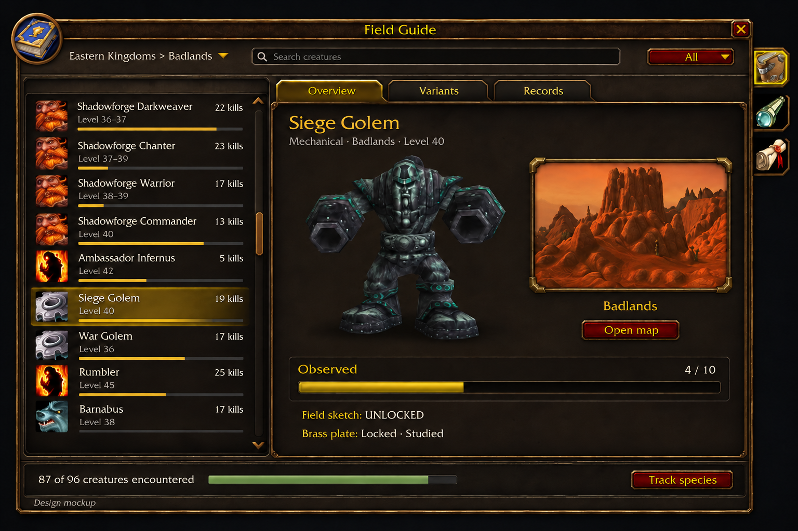

# Field Guide composition proposal

One proposed full-panel lockup for owner review. This AI-generated image communicates composition,
not exact native assets or a working client capture. It is not a README/store screenshot.

## Composition

- Native portrait/map-style outer frame, compact search and breadcrumb header.
- Creature catalogue on the left, one detail surface on the right.
- Top-facing native tab system attached to the detail pane's upper edge; content below.
- Native creature model and framed zone illustration. The illustration is zone art, not map tiles.
- Raw cropped icon subjects with one native framing owner where the host requires a frame.
- Journal section side tabs attached to the outer rail, following SkillUp and Adventure Guide.
- Compact progress and fixed footer actions.

## Unresolved native evidence

| Surface | Direction | Required verification |
| --- | --- | --- |
| Outer frame and side rail | Portrait journal host | Native template, atlas set and layers; preserve all four current sections |
| Detail tabs | Native upper-edge attachment | PanelTopTab or initialized TabSystem top template, states and anchors |
| Zone illustration | Content inside a complete frame | Approved source art, native inset corners, crop and border layers |
| Creature icons | One border owner | Inspect source pixels, prove crop bounds and avoid a second bevel |

This concept is 3:2; runtime is 960x700. It does not approve resizing the window or dropping a section.
Implementation renders must resolve the actual size and all four sections, plus long-label and empty states.
The decorative AI corners are placeholders until replaced by verified native frame assets.

## Implementation evidence still required

Use Forever Core's `docs/ui-composition.md` evidence table before implementing this direction.
Resolve frame corners, tab art, selected states and icon crop bounds against pinned native sources.
The AI image does not approve new chrome, arbitrary gold colours or generic crops.

The current gallery is a render of the existing implementation and is not this proposed composition.
Owner review of this lockup precedes runtime and renderer changes.
